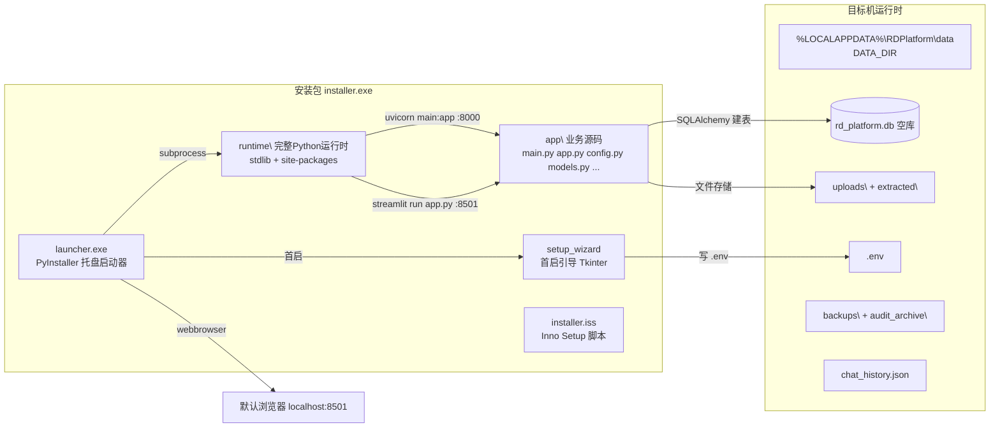
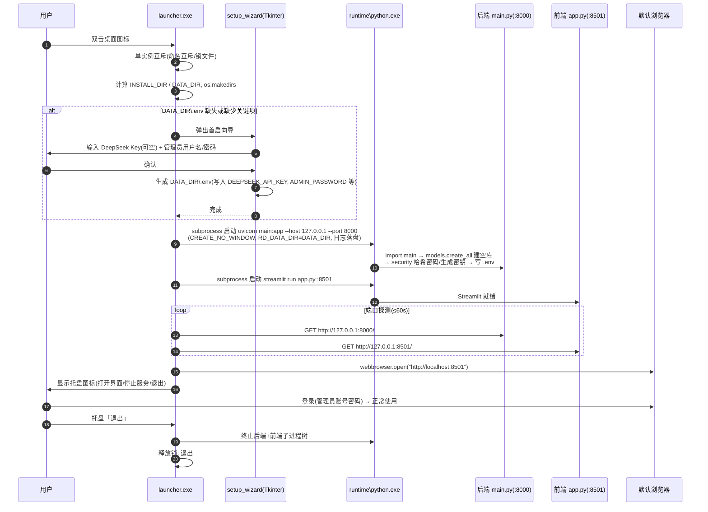

# 科技项目管理系统 · Windows 桌面安装程序 架构设计方案

> 作者：架构师（高见远）　·　性质：增量工程化（核心业务代码已存在，不改业务逻辑）
> 目标形态：Windows 桌面安装程序 → 双击安装 → 桌面/开始菜单图标 → 点开即用（单机独立版，空库启动）

---

## 0. 现状核实结论（已逐文件读码核实）

| 事实点 | 核实结果 | 影响 |
|---|---|---|
| 后端入口 | `main.py`（FastAPI，`app = FastAPI(...)` 在 L286），无 `if __name__=="__main__"`、无内嵌 `uvicorn.run`，须由外部 `python -m uvicorn main:app` 启动 | 启动器负责拉起 uvicorn |
| 前端 | `app.py`（Streamlit），`API_BASE="http://127.0.0.1:8000"` 硬编码在 L29 | 需环境变量化 |
| 数据库 | SQLite `rd_platform.db`，`config.py` L30 硬编码 `BASE_DIR/rd_platform.db` | 需指向 DATA_DIR |
| 附件/提取文本 | `UPLOAD_DIR`（`config.py` L25，支持 `.env` 覆盖，当前 `.env` 指向 `D:\sql_data`）；`EXTRACT_DIR=UPLOAD_DIR/extracted`（L26） | 需默认指向 DATA_DIR，保留 `.env` 覆盖 |
| 建表/迁移 | `models.py` L309 `Base.metadata.create_all(bind=engine)` + L310~L439 大量幂等迁移（`ALTER TABLE ...`、`INSERT OR IGNORE`），**在 import 时自动执行** | ✅ 空库首次启动自动建表，无需额外迁移脚本 |
| 密钥自举 | `security.py` 自动生成 `TOKEN_SECRET`/`BOT_TOKEN`、把明文 `ADMIN_PASSWORD` 哈希成 `ADMIN_PASSWORD_HASH` 并写 `.env`；`utils/audit_backup.py` 自动生成 `BACKUP_KEY` | ✅ 除 DeepSeek Key 与管理员密码外，其余密钥全自动 |
| 登录认证 | `main.py` L297~323 中间件：`X-Bot-Token`（QQ 机器人/内部）或 `Bearer token`（用户）；登录接口在无 `ADMIN_PASSWORD_HASH` 时返回 500 | 首启必须先配置管理员密码 |
| 后台任务 | `utils/audit_backup.py` `start_maintenance_thread()`（纯 `threading.Thread` daemon，L56 在 import 时启动）——**无 APScheduler 使用** | ✅ 单 worker 即可，无调度器兼容问题 |
| QQ 机器人 | `main.py` **不 import `qq_bot.py`**；`qq_bot.py` 是独立进程，通过 HTTP `127.0.0.1:8000` + `X-Bot-Token` 访问后端 | ✅ 单机版可安全剥离 `qq_bot.py` + `qq-botpy` + `aiohttp`，不影响任何功能 |
| main.py 顶部无效导入 | `main.py` L43~47 `import cv2 / numpy / fitz / from rapidocr_onnxruntime import RapidOCR / from openpyxl import load_workbook` **全部未在 main.py 中使用**（OCR 实际在 `utils/text_extract.py`） | 可安全删除，是「OCR 可选化」的关键前提 |
| 依赖体积 | `venv/` 实测 688MB（site-packages 663MB）；Python 3.12.10 | 见 §4 精简方案 |
| 重依赖实测 | cv2 113M / pyarrow 88M / pymupdf 54M / onnxruntime 45M / streamlit 35M / numpy 34M / rapidocr 16M / pywin32 ~12M / shapely 3.3M / botpy 0.6M | 见 §4 |

---

## 1. 总体技术选型

### 1.1 后端进程打包方式

**推荐：便携式完整 Python 运行时（python.org 解释器静默安装到 `runtime\` + 直接 `pip install` 到该解释器）**

| 方案 | 结论 | 理由 |
|---|---|---|
| ✅ **便携 Python 运行时** | **采用** | 本质是「把已验证可跑的 venv 原样搬进安装包」。`onnxruntime/opencv/pyarrow/pymupdf/pywin32` 等重原生库直接以 `.pyd`/`.dll` 形式原样部署，**零冻结、零 hook 风险**；启动即真实 Python，`streamlit run`/`uvicorn` 与开发态完全一致，启动 2~5s，无 onefile 解包开销。 |
| PyInstaller（onedir/onefile） | 备选（不推荐为主） | `rapidocr-onnxruntime` 带模型文件 + `onnxruntime` 原生 DLL + `opencv-python 5.x` 巨型 DLL，`--collect-all` 虽可工作，但每次升级依赖都可能踩 hook 缺失/DLL 丢失；onefile 首启要解包到临时目录，启动慢且杀毒误报率高。调试冻结 exe 成本高。 |
| Nuitka | 备选（不推荐） | 编译产出更小更快的单文件，但编译耗时以小时计，`onnxruntime/opencv` 兼容问题多，对本项目「重 OCR 依赖」不友好，工程复杂度高。 |
| 嵌入式 Python（embeddable） | 备选（不推荐） | 无 pip、无 tkinter，需手工拼 site-packages 与 `.pth`，且 `streamlit` 对完整 stdlib 有依赖，排障成本高。 |

> **体积与稳定性评估**：便携 Python 运行时体积 ≈ 基础解释器（~120–160MB）+ site-packages（663MB）≈ 800MB 未压缩；Inno Setup LZMA2 压缩后安装包约 **300–380MB**（保留 OCR）。稳定性最高、可复现性最强，是最契合「傻瓜化 + 重依赖」的最优解。

### 1.2 Streamlit 前端怎么装进安装程序

**推荐：便携 Python 直接 `python.exe -m streamlit run app.py`（headless），不尝试把 Streamlit 打成单个 exe。**

- Streamlit 打包是业界公认痛点（PyInstaller `--collect-all streamlit` 脆弱易碎）。既然已捆绑完整 Python 运行时，直接用运行时跑 `streamlit run` 即可，**无需对 Streamlit 做任何打包处理**。
- 启动参数：`--server.port 8501 --server.address 127.0.0.1 --server.headless true --browser.gatherUsageStats false`，并设环境变量 `STREAMLIT_SERVER_HEADLESS=true`、`STREAMLIT_BROWSER_GATHER_USAGE_STATS=false`（禁用遥测，本地不监听外网）。
- 由启动器拉起该子进程 → 探测 8501 就绪 → 用默认浏览器打开 `http://localhost:8501`。

### 1.3 启动器方案

**推荐：Python 托盘启动器 `launcher.py`（`pystray` + `subprocess` + `webbrowser` + `threading`），再用 PyInstaller 打成 windowed 单文件 `科技项目管理系统.exe`。**

| 方案 | 结论 | 理由 |
|---|---|---|
| ✅ Python 托盘（pystray） | **采用** | 与现有技术栈一致；`pystray` 成熟稳定（仅依赖 `Pillow`，通过 ctypes 调 Win32，**不额外依赖 pywin32**）；托盘菜单「打开界面/停止服务/退出」。因 `launcher` 不依赖任何重型库，PyInstaller 打包它非常容易（windowed 单文件 ~10–15MB），双击无黑窗、无需 .bat。 |
| pywebview 内嵌窗口 | 备选 | 需要目标机装 WebView2 运行时；Streamlit 在内嵌 webview 中的 Cookie/session 兼容性存疑，不如系统默认浏览器稳。 |
| 编译型启动器（Go/Rust/C#） | 备选 | 单 exe 更轻，但需额外工具链，且要自己实现端口探测/进程树管理/日志，工程成本高于 pystray 方案。 |

**启动器职责**（详见 §3 时序图）：单实例互斥 → 计算安装目录/数据目录 → 首次启动向导 → 拉起后端 uvicorn → 拉起前端 streamlit（子进程 `CREATE_NO_WINDOW`，日志落盘）→ 端口就绪探测 → 打开浏览器 → 显示托盘 → 停止/退出时终止子进程树。

### 1.4 Windows 安装程序生成

**推荐：Inno Setup 6.x（LZMA2 压缩 + 内置简体中文语言文件）**

- 免费、成熟、支持中文界面（`Languages\ChineseSimplified.isl`）、桌面 + 开始菜单快捷方式、注册表卸载项、`Run` 段可在安装完成后启动。
- 备选 NSIS：体积更小，但脚本语法晦涩、中文语言文件需另配，快捷方式与卸载体验略逊。
- 下载地址：https://jrsoftware.org/isinfo.php（官方）；或 GitHub 镜像 https://github.com/jrsoftware/issrc/releases

### 1.5 总体架构图



---

## 2. 目录与配置改造清单（最小侵入 + 向后兼容）

> 核心原则：引入 `DATA_DIR`（数据目录）与 `ENV_PATH`（.env 位置），`DATABASE_URL / UPLOAD_DIR / BACKUP_DIR / AUDIT_ARCHIVE_DIR / chat_history.json` 全部改从 `DATA_DIR` 派生；**开发态无 `RD_DATA_DIR` 环境变量、无 `_packaged` 标记时，行为完全回退到现状**（`DATA_DIR=BASE_DIR`，`rd_platform.db`、`.env`、`D:\sql_data` 覆盖均不受影响）。

### 2.1 `config.py`（核心改造，约 L5、L22、L25、L30、L45~73）

改动点：

```python
# L5 之后新增：DATA_DIR / ENV_PATH 派生逻辑（向后兼容）
def _resolve_data_dir() -> str:
    # 1) 显式环境变量优先（便携 U 盘 / 自定义数据位置）
    if os.getenv("RD_DATA_DIR"):
        return os.getenv("RD_DATA_DIR")
    # 2) 打包态：数据放 %LOCALAPPDATA%\RDPlatform\data（卸载不丢数据、Program Files 可写）
    if os.path.exists(os.path.join(BASE_DIR, "_packaged")):
        base = os.getenv("LOCALAPPDATA") or os.path.expanduser("~")
        return os.path.join(base, "RDPlatform", "data")
    # 3) 开发/旧部署：回退 BASE_DIR（保持现状）
    return BASE_DIR

DATA_DIR = _resolve_data_dir()
ENV_PATH = os.path.join(DATA_DIR, ".env")
# 向后兼容：开发态仍优先读 BASE_DIR/.env
if not os.path.exists(ENV_PATH) and os.path.exists(os.path.join(BASE_DIR, ".env")):
    ENV_PATH = os.path.join(BASE_DIR, ".env")
os.makedirs(DATA_DIR, exist_ok=True)

ENV = _load_env(ENV_PATH)            # 原 L22：改为读 ENV_PATH

# 原 L25：UPLOAD_DIR 默认改为 DATA_DIR/uploads（.env 覆盖仍优先，D:\sql_data 用法不受影响）
UPLOAD_DIR = os.getenv("UPLOAD_DIR", ENV.get("UPLOAD_DIR", os.path.join(DATA_DIR, "uploads")))
EXTRACT_DIR = os.path.join(UPLOAD_DIR, "extracted")   # 原 L26 不变
os.makedirs(UPLOAD_DIR, exist_ok=True)                # 新增：空 uploads 目录
os.makedirs(EXTRACT_DIR, exist_ok=True)               # 原 L27

# 原 L30：DATABASE_URL 指向 DATA_DIR，并导出 DB_PATH 供备份模块使用
DB_PATH = os.path.join(DATA_DIR, "rd_platform.db")
DATABASE_URL = f"sqlite:///{DB_PATH}"
```

- `_append_env` / `_remove_env`（L45~73）：把 `env_path = os.path.join(BASE_DIR, ".env")` 改为 `env_path = ENV_PATH`，使 `security.py` / `audit_backup.py` 自动生成的密钥写入 `DATA_DIR/.env`。

> **向后兼容说明**：开发态（无 `RD_DATA_DIR`、无 `_packaged` 标记）下 `DATA_DIR=BASE_DIR`、`ENV_PATH=BASE_DIR/.env`（文件已存在）、`DB_PATH=BASE_DIR/rd_platform.db`、`UPLOAD_DIR` 仍优先读 `.env` 的 `D:\sql_data`。唯一细微差异：开发态「无 `.env` 覆盖且用默认上传目录」时，默认目录名由 `BASE_DIR/data` 变为 `BASE_DIR/uploads`（两者均已在 `.gitignore`，无数据影响；如需严格一致可在 `.env` 显式 `UPLOAD_DIR=<BASE_DIR>/data`）。

### 2.2 `app.py`（约 L29、L30）

- L29：`API_BASE = os.getenv("API_BASE", "http://127.0.0.1:8000")`（`os` 已在顶部导入）。
- L30：`CHAT_HISTORY_FILE = os.path.join(DATA_DIR, "chat_history.json")`，并在顶部新增 `from config import DATA_DIR`（`config` 无 Streamlit 依赖，可安全导入；`config` 的 `os.makedirs` 会顺带创建数据目录）。

### 2.3 `main.py`（约 L43~47）

- **删除 L43~47 的无效导入**：`import cv2` / `import numpy as np` / `import fitz` / `from rapidocr_onnxruntime import RapidOCR` / `from openpyxl import load_workbook`（经核实 main.py 全部未使用，OCR 实现在 `utils/text_extract.py`）。删除后：
  - 减少启动内存、缩短导入时间；
  - 让 main.py 不再硬依赖 OCR 重库，为 §4「精简 OCR」选项铺路。
  - 无任何行为变化。

### 2.4 `utils/audit_backup.py`（约 L13、L33、L54、L79）

- L13 导入：`from config import BASE_DIR, ENV, UPLOAD_DIR, logger, _append_env` → 增加 `DATA_DIR, DB_PATH`（`BASE_DIR` 若后续不再使用可移除）。
- L33：`BACKUP_DIR = os.path.join(DATA_DIR, "backups")`（原 `BASE_DIR`）。
- L54：`AUDIT_ARCHIVE_DIR = os.path.join(DATA_DIR, "audit_archive")`（原 `BASE_DIR`）。
- L79：`db_path = DB_PATH`（原 `os.path.join(BASE_DIR, "rd_platform.db")`）——否则数据库移到 DATA_DIR 后备份会打不到库。

### 2.5 无需改动（保持原样）

- `database.py`：继续 `from config import DATABASE_URL`，无需改动。
- `models.py`：`Base.metadata.create_all` + 迁移逻辑已在 import 时执行，空库自动建表，无需改动。
- `security.py`：通过 `_append_env/_remove_env`（已指向 `ENV_PATH`）自动生成/写入密钥，无需改动。
- `routers/auth.py`、`utils/storage.py`、`utils/ai.py`、`constants.py`、`ui_common.py`：无需改动。

### 2.6 打包时排除清单（不得打包现有业务数据）

打包时**只拷贝源码与配置模板，严禁打包**：`rd_platform.db`、`.env`（真实密钥）、`data/`、`uploads/`、`backups/`、`audit_archive/`、`chat_history.json`、`*.log`、`项目管理/`、`融合*/`、`*.pdf/*.doc*/*.xls*/*.png/*.jpg/*.zip`、`qq_tmp/`、`venv/`（改用 runtime）、`migrate_storage.py`、`reidentify_achievements_batch.py`（运维脚本，不随安装包发布）。

---

## 3. 首次启动初始化流程

> 空库建表：`models.py` 的 `create_all` 在 `main.py` import 时自动执行，因此**只要 DATA_DIR 可写、DATABASE_URL 指向它，空库即自动创建**，无需额外迁移脚本。

### 3.1 首启引导方案

**推荐：启动器内置首启向导 `setup_wizard.py`（Tkinter 标准库，无需新增依赖）**

| 方案 | 结论 | 理由 |
|---|---|---|
| ✅ 首启向导（Tkinter） | **采用** | 标准库自带、无新增依赖；在**后端启动前**收集 DeepSeek Key + 管理员用户名/密码写入 `.env`，之后 `security.py` 自动把明文密码哈希化。最简单、最可控。 |
| Inno Setup 安装时输入 | 备选 | 需自定义 Pascal 表单页，且安装向导输入体验、校验、回改都不如首启向导灵活。 |
| Streamlit 首启配置页 | 备选 | 需后端新增 `/setup` 端点 + 前端加初始化页，侵入稍大；且登录接口在无密码时会 500，需先绕过，复杂度高。 |

### 3.2 首启时序



> 说明：DeepSeek Key 允许留空跳过（智能问答/文件分类/OCR 字段抽取等 AI 能力会降级为兜底/报错，用户后续可在「系统配置」或直接编辑 `.env` 补填）；管理员密码必填，否则无法登录。

---

## 4. 依赖精简方案

### 4.1 必须保留 / 可剥离 / 可选

| 依赖 | 决策 | 说明 |
|---|---|---|
| fastapi / uvicorn / starlette / pydantic / sqlalchemy / python-multipart | ✅ 保留 | 后端核心 |
| streamlit / requests / numpy / pandas / pyarrow / pydeck / altair | ✅ 保留 | 前端核心；pyarrow 是 Streamlit dataframe 序列化依赖，勿删 |
| openpyxl / xlrd / xlsxwriter / python-docx / python-pptx / pypdf / pymupdf | ✅ 保留 | 文件解析核心（pymupdf 用于 PDF 文字层提取，与 OCR 无关，必留） |
| cryptography / cffi / lxml / Pillow / tzdata / tzlocal | ✅ 保留 | 加密备份 / 解析 / 托盘图标依赖 |
| cv2 + onnxruntime + rapidocr-onnxruntime | ⚖️ 见 4.2 | OCR 成果识别（扫描件/图片文字） |
| pywin32 | ⚖️ 可选 | 仅 `.doc` 解析用（且需目标机装 MS Word；`.docx` 走 python-docx 不依赖它）。**单机版建议剥离**，`.doc` 上传自动降级为提示文案（`text_extract.py` L193 已有兜底） |
| qq-botpy + aiohttp（及 aiosignal/frozenlist/yarl/multidict/propcache） | ❌ 剥离 | 仅 `qq_bot.py` 使用；单机版剥离 QQ 机器人后整族可删 |
| APScheduler | ❌ 剥离 | 已核实无任何 import（后台维护用纯 threading 线程） |
| shapely | ❌ 剥离 | 已核实无 import（历史遗留） |
| watchdog | ❌ 剥离（可选） | Streamlit 热重载依赖；headless 部署可删 |

### 4.2 OCR 保留 vs 精简（关键决策）

| 选项 | 体积（未压缩） | 功能影响 | 结论 |
|---|---|---|---|
| ✅ **保留 OCR（推荐）** | 完整包约 800MB，安装包约 **300–380MB** | 扫描件 PDF/图片/证书照可自动识别字段——这是「成果台账自动识别」的核心卖点 | 推荐保留；对普通同事「上传扫描证书即自动登记」体验是刚需 |
| 精简 OCR | 省 cv2(113M)+onnxruntime(45M)+rapidocr(16M)≈174M，安装包约 **230–280MB** | 仅能提取有文字层的 PDF/Word/Excel；扫描件与图片无法识别（上传自动识别降级为「请手动登记」） | 仅在用户明确要求减重时采用 |

> 若选精简 OCR，需将 `utils/text_extract.py` 的 `cv2/fitz/RapidOCR` 改为 `try/except ImportError` 懒加载，`_pdf_needs_ocr` 恒返回 False、`_extract_text_from_image` 返回「未启用 OCR」提示；`main.py` L43~47 已建议删除无效导入。二者配合即可做到「删包即降级、留包即全功能」。

### 4.3 建议的运行时依赖（`requirements-runtime.txt`）

在现有 `requirements.txt` 基础上：**移除** `qq-botpy`、`aiohttp`、`aiosignal`、`frozenlist`、`yarl`、`multidict`、`propcache`、`APScheduler`、`shapely`、`watchdog`、`pywin32`（若剥离 .doc）；**保留其余全部**（含 OCR 三件套，走推荐方案）。构建期单独提供 `requirements-build.txt`（见 §6）。

---

## 5. 任务分解清单（给工程师寇豆码的执行依据）

> 约束：不改业务逻辑与表结构；每条含「依赖 / 涉及文件 / 验收标准」。T02、T03 可并行（都只依赖 T01）。

| Task | 名称 | 依赖 | 涉及文件（相对打包工程） | 验收标准 |
|---|---|---|---|---|
| **T01** | 打包工程骨架 + 依赖拆分 + 安装脚本骨架 | — | `packaging/installer.iss`、`packaging/build.bat`、`packaging/requirements-runtime.txt`、`packaging/requirements-build.txt`、`packaging/.env.example`、`packaging/app.ico`、`packaging/exclude.lst` | 目录结构就绪；runtime/build 两份依赖清单与 `.env.example` 模板可解析；`build.bat`/`installer.iss` 空骨架能跑通到「编译失败但结构正确」 |
| **T02** | 运行配置改造（路径可迁移 + 空库初始化 + OCR 可选） | T01 | `config.py`、`utils/audit_backup.py`、`app.py`、`main.py`、`utils/text_extract.py`（可选）、`security.py`（复核不改） | 见 §2：设置 `RD_DATA_DIR` 后，`DATABASE_URL/UPLOAD_DIR/EXTRACT_DIR/BACKUP_DIR/AUDIT_ARCHIVE_DIR/chat_history.json/.env` 全部落在 DATA_DIR；空库首次启动自动建表；删除 `main.py` L43~47 无效导入；开发态回退行为不变（`D:\sql_data` 覆盖仍生效） |
| **T03** | 桌面启动器 + 首启引导 | T01 | `packaging/launcher.py`、`packaging/setup_wizard.py`、`packaging/launcher.spec` | 双击 launcher 能：单实例互斥→首启向导写 `.env`→拉起 uvicorn(:8000) 与 streamlit(:8501)（无黑窗）→探测就绪→开浏览器→托盘「打开/停止/退出」；退出能清理子进程树 |
| **T04** | 构建脚本 + Inno Setup 定稿 + 依赖精简落实 | T02, T03 | `packaging/build.bat`（定稿）、`packaging/installer.iss`（定稿）、`packaging/requirements-runtime.txt`（定稿）、`packaging/README.md` | `build.bat` 一键产出 `科技项目管理系统安装包.exe`：静默装 Python→装 runtime 依赖→拷贝 app 源码（不含数据）→PyInstaller 打 launcher.exe→ISCC 编译安装脚本；安装包含中文界面、桌面+开始菜单快捷方式、卸载项、卸载保留/可选删除数据 |
| **T05** | 干净机冒烟测试 + 发布文档 | T04 | `docs/app-packaging-design.md`（本文档定稿）、`packaging/CHECKLIST.md`、`README.md`（用户说明） | 在干净 Windows 上：双击安装→首启向导→自动起服务→登录→建项目/传文件(含扫描件 OCR)/合同/经费/成果/问答/备份全链路通过；卸载后数据按策略保留 |

### 5.1 任务依赖图


---

## 6. 依赖包 / 工具清单

### 6.1 打包需新增的 Python 包（构建期，不随运行包分发）

```
pystray>=0.19        # 托盘启动器
pyinstaller>=6.0     # 仅用于把 launcher.py 打成 windowed exe
# （Pillow 已存在于 requirements.txt，pystray 依赖它）
```

### 6.2 Windows 工具

| 工具 | 用途 | 下载地址 |
|---|---|---|
| Inno Setup 6.x | 生成安装程序（中文、快捷方式、卸载） | https://jrsoftware.org/isinfo.php ；GitHub: https://github.com/jrsoftware/issrc/releases |
| Python 3.12.10 Windows x64 安装器 | 便携运行时（静默装到 `runtime\`） | https://www.python.org/downloads/release/python-31210/ |

### 6.3 安装包目录结构（目标态）

```
{app}\
├─ 科技项目管理系统.exe      # launcher（PyInstaller windowed）
├─ _packaged                  # 打包态标记（config 据此识别 DATA_DIR 策略）
├─ app\                       # 业务源码（只读）
│  ├─ main.py  app.py  config.py  models.py  database.py  security.py
│  ├─ constants.py  ui_common.py
│  ├─ routers\  utils\
├─ runtime\                   # 完整便携 Python（stdlib + site-packages）
│  ├─ python.exe  python312.dll
│  └─ Lib\site-packages\...
└─ （卸载时可选删除）data\ 首次启动才创建，实际位于 %LOCALAPPDATA%\RDPlatform\data
```

---

## 7. 待确认事项（需用户拍板）

| # | 事项 | 我的建议（默认值） |
|---|---|---|
| 1 | **OCR 是否保留**（体积：完整 ~300–380MB vs 精简 ~230–280MB） | 保留（成果自动识别是核心卖点） |
| 2 | **DeepSeek API Key 与管理员密码的配置方式**：首启向导 / 安装时输入 / Streamlit 页 | 首启向导（Tkinter），Key 可留空跳过 |
| 3 | **是否保留登录认证**（当前有 admin 登录） | 保留（数据敏感，单机也要登录） |
| 4 | **数据目录位置**：`%LOCALAPPDATA%\RDPlatform\data`（卸载保留）vs 随安装目录（卸载可能误删） | `%LOCALAPPDATA%`，卸载默认保留 + 可选勾选删除 |
| 5 | **安装包体积容忍度** | 可接受 300–380MB（若不能接受，再走精简 OCR） |
| 6 | **QQ 机器人是否剥离** | 剥离（单机版无服务器端远程需求） |
| 7 | **`.doc` 解析（pywin32）是否保留**（需目标机装 MS Word） | 剥离（`.docx` 不受影响，`.doc` 降级提示） |
| 8 | **应用显示名称 / 图标**：是否用「科技项目管理系统」+ 提供品牌图标 | 待用户提供 `.ico` 或默认用内置图标 |
| 9 | **安装路径默认值**：`%LOCALAPPDATA%\Programs\科技项目管理系统` 还是用户自选 | 默认前者（免管理员权限），允许用户改 |
| 10 | **打包用 Python 版本** | 3.12.10（与现 venv 一致） |
