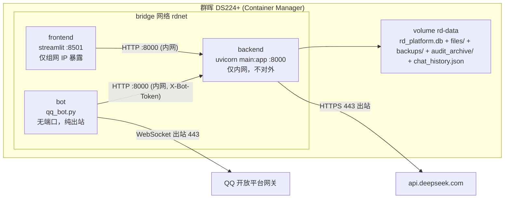

# 「研发知识智能管理平台」部署群晖 DS224+ 架构论证报告

> 架构评审结论：**有条件可行**。系统自身安全底子不错，技术栈在 x86_64 Linux 全部有官方 wheel（唯一例外是 `pywin32`，需剥离）。**核心瓶颈是内存**：DS224+ 默认 2GB 跑「三进程 + OCR」不够，需扩容（官方最高 6GB，社区可上 8/16GB）。安全上推荐 **Tailscale 组网 + 不暴露任何公网端口**；远程操作首推「路径 A（QQ 机器人，纯出站，无需入站暴露）」，路径 B 需先向 WorkBuddy 官方确认部署能力，但已有**不依赖它的替代路径（后端完整 REST API → MCP Server 封装）**。

---

## 1. 结论摘要

| 维度 | 结论 |
|---|---|
| 总体可行性 | ✅ **有条件可行**（需先完成依赖剥离 + 内存扩容 + 数据迁移三件事） |
| CPU（J4125 4C/4T，无 AVX） | ✅ 够用，但 OCR / 大模型预处理偏慢，属「能跑、不追求快」 |
| 内存（默认 2GB） | ⚠️ **不足**，必须扩容（推荐 6GB 起、8GB 更稳） |
| 依赖（x86_64 Linux） | ✅ 全部有 manylinux wheel，**仅 `pywin32` 需剥离** |
| 出网 | ✅ 需 443 出网（DeepSeek API + QQ 网关），无需入站 |
| 安全结论一句话 | **只要不把端口直接映射到公网、改用 Tailscale 组网 + 密钥最小权限，即可安全落地** |

---

## 2. 部署可行性论证

### 2.1 现有系统事实核对（已读源码确认）

- 后端 `main.py`（FastAPI + uvicorn :8000），前端 `app.py`（Streamlit :8501），QQ 机器人 `qq_bot.py`（`qq-botpy`，纯出站 WebSocket）。
- 前端 `API_BASE` **硬编码** `http://127.0.0.1:8000`（`app.py:29`）——容器化必须改成环境变量。
- 数据库 `DATABASE_URL` **硬编码**为 `BASE_DIR/rd_platform.db`（`config.py:30`）——需做成可配置。
- 文件存储 `UPLOAD_DIR` 已支持 `.env` 覆盖为绝对路径（`config.py:25`），当前 `.env` 指向 **Windows 路径 `D:\sql_data`**——迁移时改为卷内 Linux 路径即可。
- 认证中间件：`PUBLIC_PATHS = {"/", "/auth/login", "/docs", "/openapi.json", "/redoc"}`，其余全部要求 `X-Bot-Token`（内部）或 Bearer/`?token=`（用户）。
- OCR：`ThreadPoolExecutor(max_workers=2)` + 全局 `_ocr_lock` 串行化；RapidOCR 懒加载，模型约 15–20MB，OCR 时工作集可冲到数百 MB。
- `.doc` 解析依赖 `pywin32 + MS Word COM`（`utils/text_extract.py:188-217`），Linux 上会优雅降级为提示文案（ImportError 被捕获），不影响其它功能。

### 2.2 Docker 部署拓扑（推荐：单 compose、三容器）

要点：
1. **一个 `docker-compose.yml`、三个 service**（backend / frontend / bot），共享一个 `bridge` 网络。三个进程本就在 Windows 上分开跑，容器化后天然一对一，职责清晰、可独立重启。
2. **backend 不对外映射端口**（或只 `127.0.0.1:8000` 供本地调试）；frontend 只绑定到 NAS 内网/Tailscale 网段；bot 完全无端口（纯出站 WebSocket）。
3. **持久化用单个 named volume**（或 bind 到 NAS 共享目录），挂载：`rd_platform.db`、`UPLOAD_DIR`（文件本体 + `extracted/` 文本）、`backups/`、`audit_archive/`、`chat_history.json`、`qq_tmp/`（可放 tmpfs）。
4. 建议增加一个**极小代码改造**：引入 `DATA_DIR` 环境变量，让 `DATABASE_URL` 与 `UPLOAD_DIR` 都落到 `/data` 下，这样**只需挂一个卷**即可整体迁移/备份，彻底避免「单文件 bind-mount」的坑。

### 2.3 依赖在 x86_64 Linux 的可用性

| 依赖 | 用途 | Linux x86_64 wheel | 备注 |
|---|---|---|---|
| opencv-python 5.x | OCR 图像预处理 | ✅ manylinux | **建议换 `opencv-python-headless`**，省去 libGL/libgtk 依赖（代码只用 imdecode/resize/CLAHE/cvtColor，无 GUI） |
| onnxruntime 1.x | RapidOCR 推理 | ✅ manylinux | 官方默认 CPU wheel 为 baseline 构建，**J4125 无 AVX 也能跑**（偏慢） |
| rapidocr-onnxruntime | OCR 引擎 | ✅ 纯 Py + onnxruntime | 自带模型，首次调用加载慢，正常 |
| pymupdf (fitz) | PDF 解析/渲染 | ✅ manylinux | 无问题 |
| pyarrow / pandas / numpy / shapely | 数据处理 | ✅ 均 manylinux | 无问题 |
| streamlit / fastapi / uvicorn / qq-botpy | 应用层 | ✅ 纯 Py | 无问题 |
| cryptography / cffi / lxml / openpyxl | 加密/解析 | ✅ 均 manylinux | 无问题 |
| **pywin32 312** | 仅 `.doc` 解析 | ❌ **Windows 专属，Linux 不可装** | **必须从 requirements.txt 剥离**；`.doc` 在 NAS 上降级为「只存不解析」 |

⚠️ **风险提示**：`requirements.txt` 里部分版本号（如 `cryptography==50.0.1`、`pandas==3.0.5`、`streamlit==1.62.0`、`pyarrow==25.0.1` 等）疑似在 Windows 侧从某个镜像生成，**部署前务必在 Linux 侧重新核对 PyPI 上确有对应 manylinux wheel**（最稳妥做法：在 Linux 容器内 `pip install -r` 实测，必要时重新 lock）。

### 2.4 内存与 CPU 评估

**内存（关键瓶颈）：**

| 组件 | 稳态占用（估） |
|---|---|
| DSM 7.x 系统 + 基础套件 | ~0.6–0.9 GB |
| backend（uvicorn 单 worker） | ~0.15–0.25 GB |
| frontend（streamlit） | ~0.25–0.4 GB |
| bot（qq-botpy） | ~0.12–0.2 GB |
| RapidOCR 模型常驻 + 推理峰值 | ~0.2 GB 常驻 / 峰值可再 +0.5–0.8 GB |
| **合计稳态** | **~1.4–1.8 GB** |
| **OCR 峰值** | **可达 2.5–3 GB** |

- **结论：默认 2GB 不够**，OCR 峰值会触发 Linux OOM，可能杀掉 OCR 线程或整个容器。
- **建议**：扩容到 **6GB（官方最高）或 8GB（社区广泛验证）**，并给 NAS 配适量 swap 兜底。当前 `max_workers=2 + 全局锁` 已把 OCR 事实串行化，是**正确的内存控制手段**，扩容后无需改并发。

**CPU（J4125，Gemini Lake，无 AVX/AVX2）：**
- FastAPI/Streamlit/SQLite 查询均为轻负载，完全够用。
- OCR（RapidOCR@200DPI）估算 **0.5–2 秒/页**，扫描件批量入库会慢，但属「后台线程池异步」不阻塞上传，个人使用可接受。
- 大模型推理不发生在本地（走 DeepSeek 云端 API），**本地 CPU 压力主要来自 OCR**。

### 2.5 出网要求

| 目标 | 端口 | 用途 |
|---|---|---|
| api.deepseek.com | 443 | 问答/摘要/分类/关键词扩展 |
| api.sgroup.qq.com（QQ 网关） | 443 | 机器人 WebSocket 长连接 |
| *.myqcloud.com（COS 预签名 URL） | 443 | QQ 文件分片上传 |
| registry-1.docker.io（或镜像加速） | 443 | 拉取基础镜像（仅构建时） |
| DNS | 53 | 域名解析 |
| 时区 | — | 容器设 `TZ=Asia/Shanghai`（备份文件名用本地时间、APScheduler 定时任务依赖正确时区） |

### 2.6 Windows bat → Linux/Docker 改造点清单

| # | 现状 | 改造 |
|---|---|---|
| 1 | `requirements.txt` 含 `pywin32` | 移除；`.doc` 降级（可选加 LibreOffice headless 兜底） |
| 2 | `opencv-python` | 换 `opencv-python-headless` |
| 3 | `app.py` 硬编码 `API_BASE=127.0.0.1:8000` | 改读环境变量 `API_BASE`（compose 内用服务名 `http://backend:8000`） |
| 4 | `config.py` DB 路径固定 `BASE_DIR/rd_platform.db` | 引入 `DATA_DIR`/`DB_PATH` 环境变量，落到挂载卷 |
| 5 | `start_all.bat` 起 3 个独立窗口 | 换成 `docker-compose.yml` 三 service + `restart: unless-stopped` |
| 6 | 后端 `--host 127.0.0.1` | 容器内 `--host 0.0.0.0`（仅 compose 内网可见，不对外映射） |
| 7 | `.env` 明文密钥 | compose `env_file`/Docker secrets，`.env` 不进镜像不进仓库 |
| 8 | `UPLOAD_DIR=D:\sql_data` | 迁移数据到卷 `/data/files`，改 `.env` 指向 Linux 路径 |
| 9 | 无健康检查 | backend 用 `GET /` 做 healthcheck |

---

## 3. 安全性论证

### 3.1 系统自身安全现状评估

**已具备（底子不错）：**
- ✅ PBKDF2-SHA256 **20 万次**迭代哈希（`security.py:17`）
- ✅ HMAC 无状态 token，**7 天过期 + 改密即失效**（版本号机制）
- ✅ 内部服务令牌 `BOT_TOKEN` 走 `X-Bot-Token` 头 + `hmac.compare_digest` 恒时比较
- ✅ Fernet 加密备份 + 自动保留份数 + 定时归档
- ✅ `AuditLog` 审计（登录/增删改/下载/问答）+ IP 记录 + 归档
- ✅ QQ openid 白名单（`.env` 的 `QQ_ALLOWED_OPENIDS`）
- ✅ 备份下载文件名白名单正则，防目录穿越

**仍缺失 / 需补齐（按风险排序）：**
1. 🔴 **`/docs`、`/openapi.json` 属公开路径**——若后端可达，会泄露完整 API 结构（`PUBLIC_PATHS` 含 `/docs`）。生产应关闭或加保护。
2. 🔴 **登录接口无防爆破**（无失败锁定/限速/延迟）——公网可达时必须加。
3. 🔴 **`BOT_TOKEN` 一旦泄露 = 全量权限**——中间件里 bot 凭 `X-Bot-Token` 通过后即可访问**任意接口（含删除/写）**，虽当前 bot 只调 4 个只读接口，但令牌权限本身未收窄。建议中间件对 bot 增加**路径白名单**（仅 `/ask` `/search` `/files/{id}/download` `/cross-project/analyze`）。
4. 🟠 **无 HTTPS**——裸 HTTP 暴露时必须前置 TLS 反代或走 Tailscale 加密通道。
5. 🟠 **改密最短仅 6 位**（`auth.py:69`）——对管理员偏弱，建议 ≥12。
6. 🟠 **`?token=` 查询参数鉴权**——下载链接会把 token 放进 URL，可能残留于日志/历史，公网场景有泄露面。
7. 🟠 **无 2FA / 无登录失败告警**。
8. 🟡 SQLite 备份用「读文件 → 打包」而非 `sqlite3` 一致快照，极端并发下备份可能读到中间态（影响小）。
9. 🟡 Streamlit 进程自身无 HTTP 鉴权（靠后端 token），**不应暴露到公网**。

### 3.2 外网暴露风险分层

| 暴露方式 | 风险等级 | 说明 |
|---|---|---|
| 直接端口映射裸奔（8000/8501 明文） | 🔴 高 | 无加密、无 WAF、直接命中后端，被扫到即可能爆破/利用 |
| 仅 QuickConnect 转发 | 🟠 中 | 走 Synology 中继 + 账号 2FA，但依赖官方链路、可控性弱 |
| 公网 IP + DDNS + 反向代理 + TLS | 🟡 中 | 可控但需维护域名/证书/开放 80/443，暴露面仍在 |
| **Tailscale 组网（零公网端口）** | 🟢 低 | WireGuard 端到端加密、无公网暴露、ACL 可控，**首选** |

### 3.3 推荐安全方案与理由

1. **组网优先**：NAS 装 Tailscale，手机/笔记本进同一 tailnet；**关闭路由器所有端口转发**，DSM 与容器只监听内网/tailnet IP。
2. **密钥与 `.env`**：`chmod 600`；用 compose `env_file` 注入而非打进镜像；`TOKEN_SECRET`/`BOT_TOKEN`/`BACKUP_KEY`/`DEEPSEEK_API_KEY` 全部视为最高密级，**备份密钥 `BACKUP_KEY` 需单独异地保存**（丢失无法解密历史备份）。
3. **最小权限**：backend 不出容器网络；bot 加路径白名单；frontend 仅在组网内可达；DeepSeek 用独立 API Key 并设额度告警。
4. **登录保护**：加登录失败限速/延迟/锁定；强密码 ≥12；条件允许加 2FA。
5. **备份 3-2-1**：应用内 Fernet 加密备份（本机）+ Hyper Backup/Cloud Sync 定期把 `backups/` 导出到**异地或第二介质**。
6. **加固收尾**：关闭 `/docs`；升级依赖（尤其 `cryptography`）；DSM 打补丁；容器 `read_only` rootfs + 仅数据卷可写。

---

## 4. 远程访问方案对比

| 方案 | 需公网 IP | 暴露面 | 安全性 | 省心度 | 成本 | 速度 | 结论 |
|---|---|---|---|---|---|---|---|
| **Tailscale** | 否 | 无端口暴露 | 高（WireGuard 端到端加密 + ACL） | 高（装客户端即用） | 个人版免费 | 高（P2P 直连，失败走中继） | ⭐ **推荐** |
| 群晖 QuickConnect | 否 | 经 Synology 中继 | 中（依赖官方 + 2FA） | 高（账号即用） | 免费 | 中（中继转发较慢） | 备选 |
| 公网 IP + DDNS + 反向代理 + TLS | 是 | 开放 80/443 | 中（需持续运维） | 低 | 域名+证书 | 高 | 不推荐（除非必须对外 Web） |
| FRP 内网穿透 | 否（需 VPS） | 开放 VPS 端口 | 中（自管） | 低（自建自维护） | VPS 费用 | 中 | 不推荐（有更优替代） |

**推荐结论**：结合「最安全、最省心、无公网 IP 优先」——**主推 Tailscale**；QuickConnect 作为「应急兜底/远程管理 DSM 本身」的备选。**注意：QQ 机器人路径不需要任何远程访问方案**（纯出站，见下）。

---

## 5. 远程操作双路径论证

### 路径 A：QQ 机器人（✅ 推荐首选）

**客观事实**：`qq_bot.py` 用官方 `qq-botpy` SDK，**主动出站 WebSocket 连腾讯网关**，由网关把单聊消息推给本地进程；本地进程再调后端 `127.0.0.1:8000`（`/ask` `/search` `/files/{id}/download` `/cross-project/analyze`，带 `X-Bot-Token`）。

**安全边界评估：**
- ✅ **无需任何入站暴露**——这是最核心的优势，天然规避端口映射/爆破风险。
- ✅ 已有 openid 白名单；✅ 内部调用走 `BOT_TOKEN`。
- ⚠️ 部署前务必**显式配置 `QQ_ALLOWED_OPENIDS`**，关闭「首个发消息者自动授权」的便利（`qq_bot.py:161-164`），否则第一个误连的陌生人会被自动授权。
- ⚠️ 建议给 bot 加**路径白名单**（见 3.1-3），把 `BOT_TOKEN` 从「全量权限」收窄到「只读查询权限」。
- 限制：仅文字问答/检索/下载/报告；单文件 ≤150MB；不能做完整后台管理（增删改台账）——**正好符合「手机端查数据/传文件」的定位**。

**与 NAS 共部署**：bot 作为 compose 第三个 service，与 backend 同网段，无额外暴露。

### 路径 B：WorkBuddy（⚠️ 需官方确认 + 已有替代路径）

**客观事实**：WorkBuddy 是腾讯的 AI 助手产品，**当前以本地桌面/IDE 环境运行**（本会话即运行在用户本地 Windows），通过 MCP/工具连接外部服务。「远程操作」的**本质** = 让某个客户端能**调达 NAS 上后端的 REST API**。

**结论**：WorkBuddy **是否支持独立部署到 NAS/云端，当前无定论，需向 WorkBuddy 官方确认**（不臆造其部署能力）。

**不依赖该能力的替代路径（可落地）：**
1. ⭐ **MCP Server 封装**（推荐）：后端已有**完整 REST API + OpenAPI**。编写一个轻量 MCP Server，把 `/search` `/ask` `/files/{id}/download` `/cross-project/analyze` 等封装成 MCP tools，跑在 NAS（或本地）上；本地 WorkBuddy 通过 **Tailscale** 连到该 MCP Server → 即可「用 WorkBuddy 远程操作 NAS 数据」。这是标准、低风险、可立即实现的路径，且不要求 WorkBuddy 自身可部署。
2. **Web UI 直达**：手机/笔记本经 Tailscale 浏览器直接访问 `8501`（现有 Streamlit 界面），本质就是「随身远程操作」，无需额外开发。
3. **第二聊天通道（若需要）**：走**企业微信应用 / 公众号 / 群机器人**等正规渠道（规避个人微信机器人封号风险），不要自建个人微信机器人。

---

## 6. 分阶段落地步骤 + 风险清单

### 阶段 0 — 依赖与配置改造（Windows 侧先验证）
- `requirements.txt` 剥离 `pywin32`，换 `opencv-python-headless`；Linux 侧实测 `pip install`。
- `app.py` 的 `API_BASE`、`config.py` 的 DB 路径改为环境变量可配置。
- 确认 `.doc` 降级行为可接受（可选：加 LibreOffice headless 兜底）。

### 阶段 1 — Docker 化
- 写 `Dockerfile`（`python:3.11-slim`，按需补 `libgomp1`/`libglib2.0-0`）+ 三 service `docker-compose.yml` + `TZ=Asia/Shanghai` + healthcheck。
- 持久化卷；迁移 `D:\sql_data → /data/files`、`rd_platform.db → /data`。
- NAS 内网冒烟：上传/检索/问答/备份全链路。

### 阶段 2 — 组网
- NAS 装 Tailscale；手机/笔记本入同一 tailnet；ACL 最小化；**关闭路由器端口转发**。

### 阶段 3 — 远程通道
- 路径 A：配置 QQ 机器人（AppID/Secret、订阅 C2C、显式 openid 白名单）→ 验证手机查/传文件。
- 路径 B：部署 MCP Server 供 WorkBuddy 连接（或等官方部署能力确认）。
- 可选：如需公网 Web，再加 Caddy/Nginx 反代 + TLS + 域名。

### 风险与遗留问题清单

| # | 风险/问题 | 等级 | 处置 |
|---|---|---|---|
| 1 | 默认 2GB 内存不足，OCR 峰值 OOM | 🔴 | 扩容至 6/8GB + swap |
| 2 | `.env` 密钥明文、`BACKUP_KEY` 单点 | 🔴 | 权限 600 + 异地备份密钥 + 不落镜像/仓库 |
| 3 | `/docs` 公开泄露 API 结构 | 🟠 | 生产关闭或加保护 |
| 4 | 登录无防爆破、密码仅 6 位 | 🟠 | 加限速/锁定、≥12 位、可选 2FA |
| 5 | `BOT_TOKEN` 权限过大（可写/删） | 🟠 | 中间件加 bot 路径白名单 |
| 6 | `requirements.txt` 部分版本号需在 Linux 核实 | 🟠 | 部署前 Linux 侧实测 lock |
| 7 | `.doc` 在 NAS 无法解析 | 🟡 | 接受降级 / LibreOffice 兜底 |
| 8 | `?token=` 查询参数泄露面 | 🟡 | 公网场景改 Header/短时效 |
| 9 | J4125 无 AVX，OCR/推理偏慢 | 🟡 | 接受；批量任务放后台 |
| 10 | QQ 官方机器人审批/资质（q.qq.com 开发者 + 机器人创建） | 🟡 | 部署前确认账号与机器人已就绪 |

---

## 7. 待确认事项清单（需用户/官方确认）

1. **内存**：DS224+ 是否已/可扩容到 6GB 或 8GB？（这是硬前提）
2. **WorkBuddy 官方**：是否支持独立部署到 NAS/云端？（若否，走 MCP Server 替代路径，见 5-路径B）
3. **QQ 官方机器人**：q.qq.com 开发者身份与机器人是否已注册/审批通过、C2C 单聊事件是否已订阅？
4. **DeepSeek**：API Key 额度与计费是否可长期用于 NAS 侧调用？
5. **Tailscale**：用户是否有账号、能否在 NAS/手机/笔记本安装客户端？
6. **数据迁移**：`D:\sql_data` 体量多大，迁移到卷的方案（直接拷贝/应用内备份恢复）？
7. **`.doc` 存量文件**：是否有大量旧版 `.doc` 需要在 NAS 上解析（决定是否加 LibreOffice 兜底）？
8. **对外 Web 需求**：是否需要「公网域名访问 Web 界面」（决定是否加反代+TLS，还是仅 Tailscale 内访问）。
9. **版本核实**：`requirements.txt` 中各关键包在 Linux PyPI 的 manylinux wheel 可用性（阶段 0 实测确认）。
